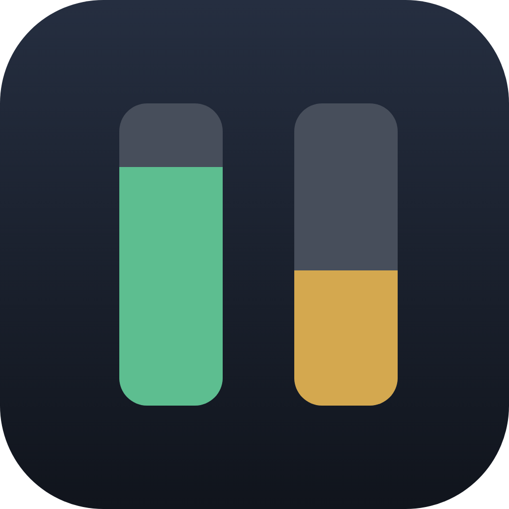
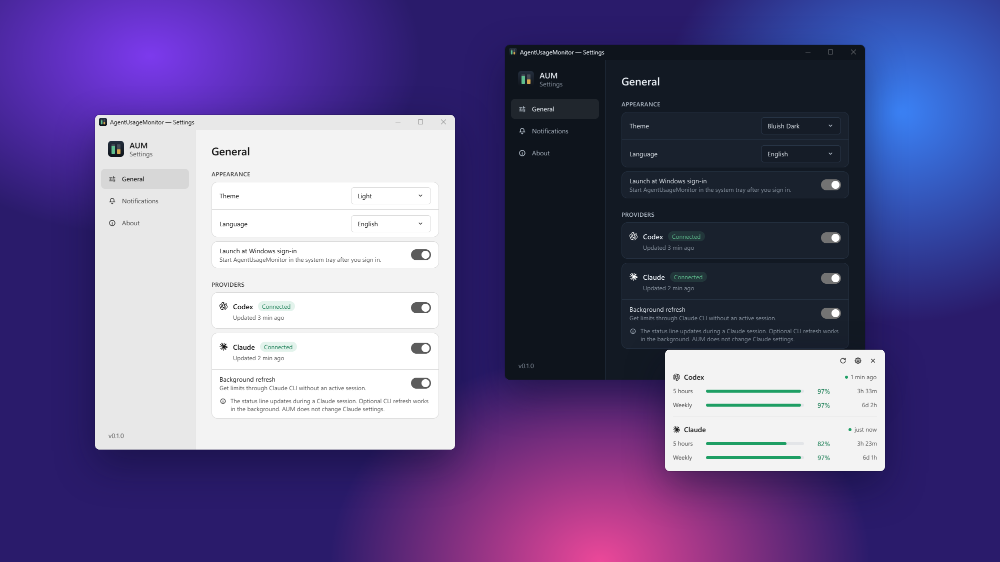
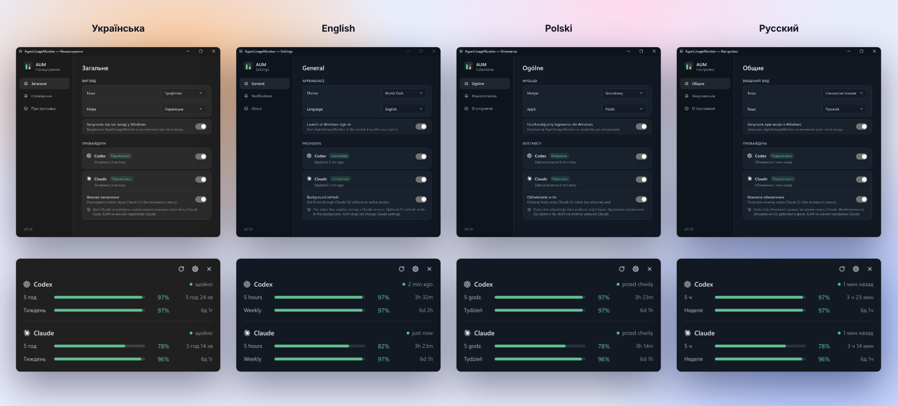
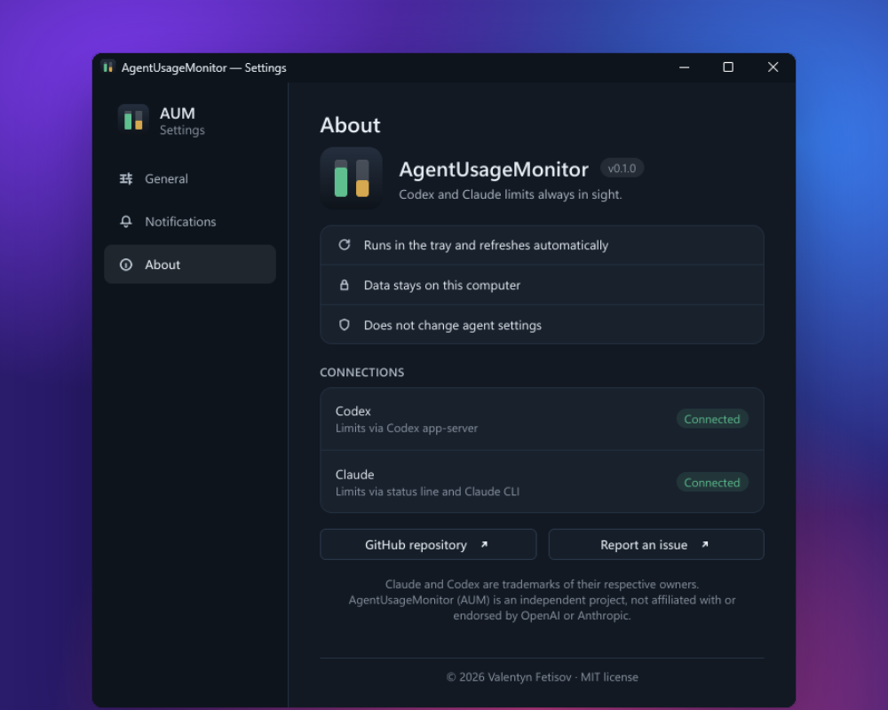

<div align="center">



# Agent Usage Monitor

**Keep Codex and Claude Code usage limits in view while you work.**

[](LICENSE)




</div>

> **Version 0.1.0 · Development build.** This project is under active development. The screenshots below are supplied showcase artwork and may depict an earlier UI iteration. They illustrate the project’s visual direction; use the feature list and limitations below as the source of truth for current behavior. No installer or released binary is currently promised.

Agent Usage Monitor (AUM) is a small Windows desktop app built with **Rust** and **Slint**. It presents supported AI coding-assistant usage windows, remaining percentages, reset countdowns, and local alerts in a compact interface.

## Features

- **Codex usage:** reads rate-limit information through the `codex app-server` interface. Live mode makes an initial request and refreshes every five minutes.
- **Claude Code (opt-in):** an optional local bridge accepts supported usage fields from Claude Code’s documented status-line JSON input. AUM does not edit Claude settings or read credentials or transcripts.
- **Usage at a glance:** separate 5-hour and weekly windows, remaining percentages, reset countdowns, and clear unavailable or stale states.
- **Windows notification area:** tray menu actions to show or hide the quota popup, open Settings, and quit; Windows notifications for configured usage thresholds.
- **Settings:** enable or disable providers, configure warning and critical thresholds, weekly alerts, and notification duration.
- **Appearance:** System, Dark, and Light themes; English, Ukrainian, and Polish interface localization.
- **Local-first preferences:** settings and alert state are stored locally in the user’s application data folder. AUM does not store provider credentials or tokens.

### Current limitations

- AUM is a development build; packaged installers and stable release binaries are not provided here.
- Claude status-line values are session-driven. They can be absent until Claude Code supplies them and can become stale when no new status-line input arrives.
- The tray icon is currently neutral; live quota-driven tray-icon updates are not connected.
- Windows notification delivery follows the user’s Windows notification and focus settings.
- Physical high-DPI appearance still needs manual review at multiple Windows scaling levels.

## Showcase

The following images are included from the supplied showcase archive. Some show a design iteration that predates the current Rust/Slint UI and may include controls or behavior that are not present in this version.

### Quota views

<table>
<tr>
<td width="50%"></td>
<td width="50%"></td>
</tr>
</table>


### Settings and appearance

<table>
<tr>
<td width="50%"></td>
<td width="50%"></td>
</tr>
</table>


### Languages and notifications




### About



## Setup

### Requirements

- Windows 10 or later
- Stable Rust toolchain (the workspace declares Rust 1.85)
- `x86_64-pc-windows-msvc` target
- Visual Studio C++ Build Tools and the Windows SDK
- Codex CLI for live Codex data

Install the Rust target if needed:

```powershell
rustup target add x86_64-pc-windows-msvc
```

### Build from source

Clone the repository and build the workspace from the `rust/` directory:

```powershell
git clone https://github.com/valenticus/agent-usage-monitor.git
cd agent-usage-monitor/rust
cargo build --workspace --release
```

The desktop executable is `target\release\agent-usage-monitor.exe`. The optional Claude bridge executable is `target\release\agent-usage-monitor-claude-bridge.exe`.

### Run modes

From the `rust/` directory, run the clearly labeled sample data mode:

```powershell
cargo run -p agent-usage-monitor-ui --bin agent-usage-monitor -- --demo
```

Run with live Codex data:

```powershell
cargo run -p agent-usage-monitor-ui --bin agent-usage-monitor -- --live
```

Enable the Claude status-line bridge explicitly alongside live mode:

```powershell
cargo run -p agent-usage-monitor-ui --bin agent-usage-monitor -- --live --enable-claude-bridge
```

Claude setup is manual and opt-in. Review [`docs/claude-status-line.md`](docs/claude-status-line.md) before configuring a status-line command. AUM does not modify Claude’s settings, and its bridge does not compose with or preserve an existing status-line command automatically.

## Portable use

AUM does not require an installer for a local source build. To run the built app from a folder or removable drive, copy `agent-usage-monitor.exe` and any required runtime files produced by your build into that folder and launch the executable. The app stores its preferences and alert state separately under `%APPDATA%\Agent Usage Monitor`; those files are not stored beside the executable. This is portable in the sense that the app can be launched from a chosen folder, but its settings are per-user rather than fully self-contained. No prebuilt portable package is currently published.

## Project structure

- `rust/agent-monitor-core/` — provider models, Codex access, alerts, and the opt-in Claude bridge.
- `rust/agent-monitor-ui/` — Slint interface, settings, themes, localization, and Windows tray integration.
- `docs/` — provider integration notes and project research.

See the [UI crate README](rust/agent-monitor-ui/README.md) for implementation details and current limitations.

## License

Agent Usage Monitor is licensed under the [MIT License](LICENSE). Copyright © 2026 Valentyn Fetisov. You may use, modify, distribute, and sell copies under the license terms; copies or substantial portions must retain the copyright and permission notices. The software is provided “AS IS,” without warranty. Third-party dependencies, names, and marks may have separate terms.

## Links

- [Source repository](https://github.com/valenticus/agent-usage-monitor)
- [Claude Code status-line setup](docs/claude-status-line.md)
- [MIT License](LICENSE)
