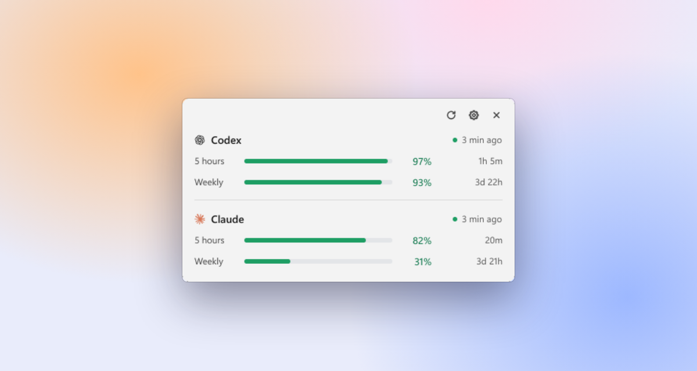
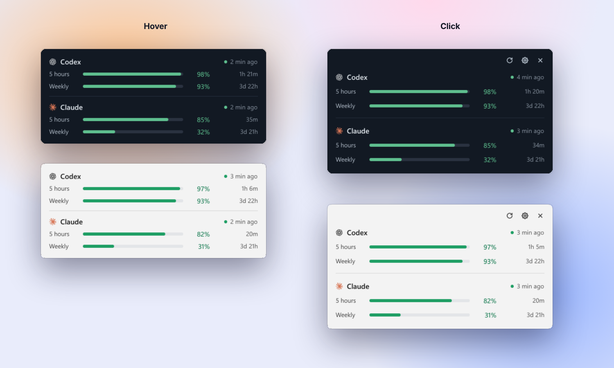
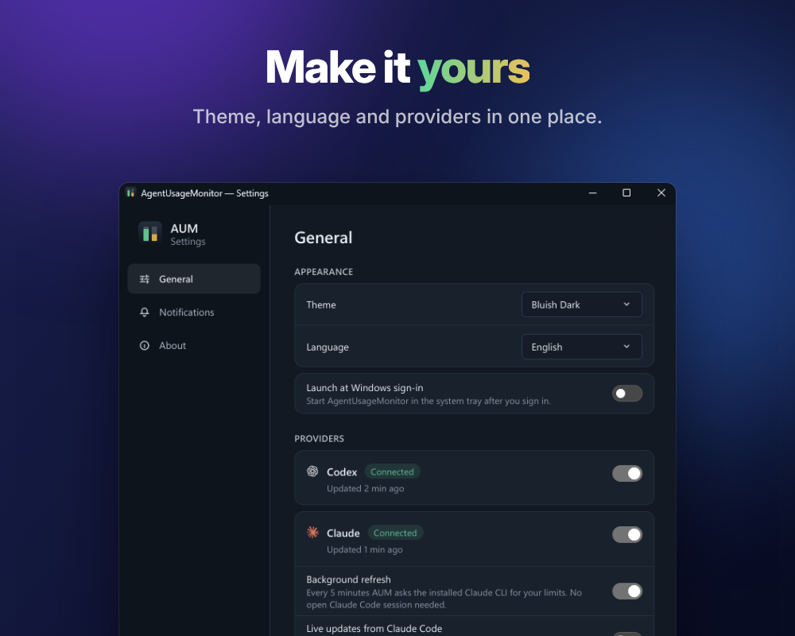
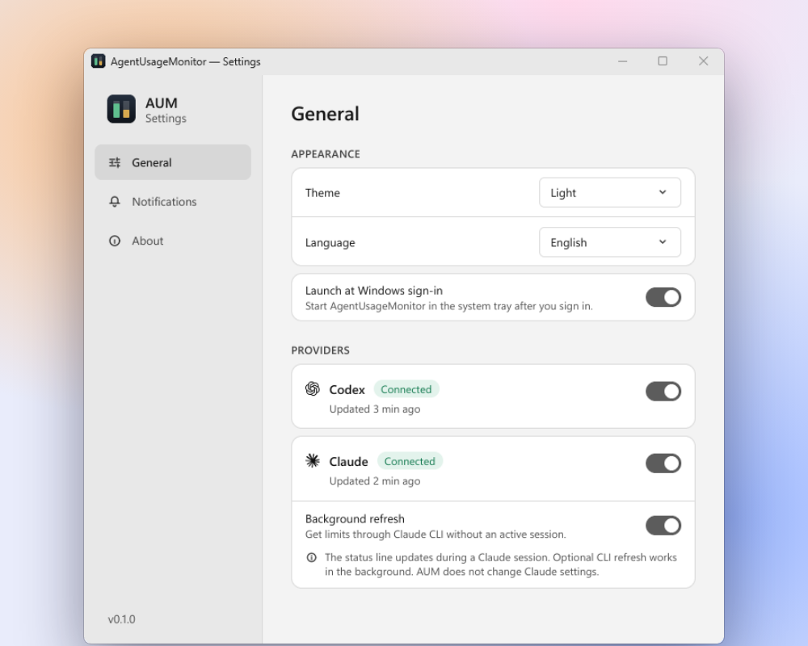
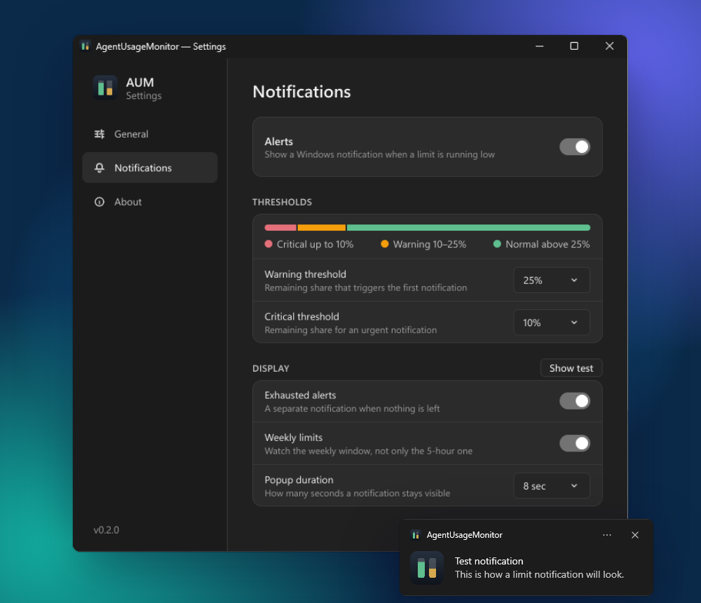

<div align="center">


# Agent Usage Monitor

**Keep Codex and Claude Code usage limits in view while you work.**

[](LICENSE)


</div>

> **Latest release: v0.1.1.** Download the Windows installer or portable ZIP from [GitHub Releases](https://github.com/valenticus/agent-usage-monitor/releases). Showcase images may reflect earlier UI iterations.

Agent Usage Monitor (AUM) is a small Windows desktop app built with **Rust** and **Slint**. It presents supported AI coding-assistant usage windows, remaining percentages, reset countdowns, and local alerts in a compact interface.

## Features

- **Codex monitoring:** read supported 5-hour and weekly quota information through the local `codex app-server`, with manual refresh and background polling.
- **Claude Code monitoring:** receive supported session data through an optional local status-line bridge. An optional Claude CLI background refresh can also retrieve usage information when explicitly enabled.
- **Clear usage overview:** remaining percentages, progress bars, reset countdowns, and unavailable states for each provider.
- **Quick tray access:** show the compact usage window, open Settings, refresh information, and quit without leaving your desktop.
- **Windows notifications:** configure warning and critical thresholds, exhausted-limit alerts, weekly alerts, and preview a test notification.
- **Appearance:** Graphite, Bluish Dark, and Light themes.
- **Localization:** English, Ukrainian, Polish, and Russian.
- **Windows startup:** opt in to launching AUM at Windows sign-in.
- **Local preferences:** settings and notification state are stored in the user's application data folder; AUM does not store provider credentials.

### Notes and limitations

- Usage information is dependent on what Codex and Claude Code expose locally. Providers may be unavailable or return incomplete or stale data.
- The Claude status-line bridge is optional; enabling Claude monitoring in the UI is not the same as installing or configuring the bridge.
- Notifications follow Windows notification settings and focus policies. The installed version integrates with Windows more completely than a portable launch.
- This is an independent community project, not an official product of OpenAI or Anthropic.
- Claude and Codex are trademarks of their respective owners. The provider marks shown in the app identify each provider only; they are not covered by the MIT license (see [brand asset notes](docs/design/brand-assets.md)).

## Showcase

The following images are included from the supplied showcase archive. Some show a design iteration that predates the current Rust/Slint UI and may include controls or behavior that are not present in this version.

### Quota views

<table>
<tr>
<td width="50%"></td>
<td width="50%"></td>
</tr>
</table>



### Settings and appearance

<table>
<tr>
<td width="50%"></td>
<td width="50%"></td>
</tr>
</table>


### Languages and notifications




### About


## Download and install

Downloads are on **[GitHub Releases](https://github.com/valenticus/agent-usage-monitor/releases)**. Each release lists SHA-256 checksums for its files.

### Windows installer (recommended)

Download `AgentUsageMonitor-0.1.1-win-x64-setup.exe`, run the setup wizard, and launch **Agent Usage Monitor**. Installation is per-user; administrator access is not normally required. Installing over an earlier version upgrades it in place and keeps your settings.

The installer can create Start Menu and optional desktop shortcuts. AUM can optionally start when you sign in to Windows. Uninstalling the application can preserve your settings for a future reinstall.

### Portable ZIP

Download `AgentUsageMonitor-0.1.1-win-x64-portable.zip`, extract the archive, and run `agent-usage-monitor.exe`.

The archive contains the main executable, the optional `agent-usage-monitor-claude-bridge.exe`, LICENSE, and documentation. The bridge executable does not need to be launched manually just to open AUM.

**Portable does not mean self-contained settings:** both distributions use `%APPDATA%\\Agent Usage Monitor` for per-user preferences and alert state. Windows notification behavior may differ without an installed Start Menu shortcut.

### Integrations

**Codex:** install and sign in to the Codex CLI. AUM reads rate-limit information through the local Codex app-server.

**Claude Code:** install and configure Claude Code separately. Session-driven usage information can be supplied through the optional status-line bridge. Optional Claude CLI background usage refresh is configurable in AUM. AUM never changes your Claude settings automatically.

For manual bridge setup, see [Claude status-line documentation](docs/claude-status-line.md). Feature availability depends on the provider's local interfaces and your configuration.

## Build from source

Requirements: Windows, a stable Rust toolchain with `x86_64-pc-windows-msvc`, Visual Studio C++ Build Tools, and the Windows SDK.

```powershell
git clone https://github.com/valenticus/agent-usage-monitor.git
cd agent-usage-monitor/rust
rustup target add x86_64-pc-windows-msvc
cargo build --workspace --release
```

The application executable is `target\\release\\agent-usage-monitor.exe`. For development, run the demo mode with:

```powershell
cargo run -p agent-usage-monitor-ui --bin agent-usage-monitor -- --demo
```

## Project structure

- `rust/agent-monitor-core/` — provider models, Codex access, Claude integration, and alerts.
- `rust/agent-monitor-ui/` — Slint interface, settings, themes, localization, notifications, and Windows tray integration.
- `docs/` — provider integration notes, design specification, and project research.

## License

Agent Usage Monitor is licensed under the [MIT License](LICENSE). Copyright © 2026 Valentyn Fetisov. You may use, modify, distribute, and sell copies under the license terms; copies or substantial portions must retain the copyright and permission notices. The software is provided “AS IS,” without warranty. Third-party dependencies, names, and marks may have separate terms.

## Links

- [Download releases](https://github.com/valenticus/agent-usage-monitor/releases)
- [Report an issue](https://github.com/valenticus/agent-usage-monitor/issues)
- [Source repository](https://github.com/valenticus/agent-usage-monitor)
- [Claude Code status-line setup](docs/claude-status-line.md)
- [MIT License](LICENSE)
