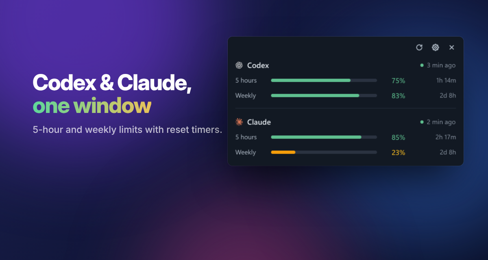
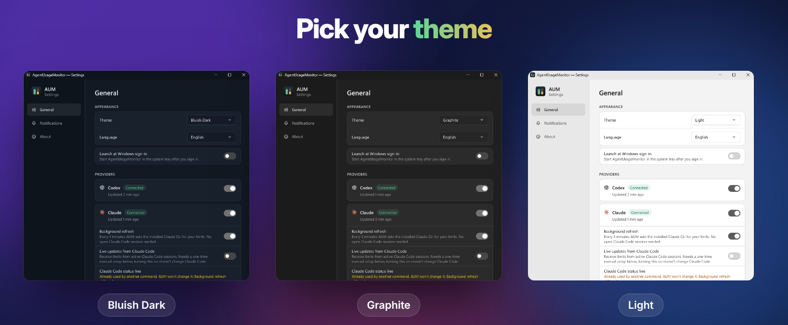

<div align="center">


# Agent Usage Monitor

**Codex and Claude Code usage limits, always in sight.**

A small Windows tray app that shows remaining quota, reset countdowns and low-limit alerts for your AI coding assistants.

[](https://github.com/valenticus/agent-usage-monitor/releases/tag/v0.2.0)
[](LICENSE)


**[Download v0.2.0](https://github.com/valenticus/agent-usage-monitor/releases/tag/v0.2.0)** · [All releases](https://github.com/valenticus/agent-usage-monitor/releases) · [Microsoft Store](https://apps.microsoft.com/detail/9N20DHG8SSS1) · [Report an issue](https://github.com/valenticus/agent-usage-monitor/issues)

<a href="https://get.microsoft.com/installer/download/9N20DHG8SSS1?referrer=appbadge">
  
</a>


</div>

## Overview

Agent Usage Monitor (AUM) sits in the Windows notification area and keeps the 5-hour and weekly usage windows of **Codex** and **Claude Code** one glance away. It reads only what the tools expose locally, shows remaining percentages with reset countdowns, and warns you with Windows notifications before a limit runs out.

AUM is built with **Rust** and **Slint**. It is an independent community project.

## Features

- **Codex monitoring:** 5-hour and weekly quota through the local `codex app-server`, with manual refresh and automatic background refresh.
- **Claude Code monitoring:** session data through an optional local status-line bridge, plus an optional Claude CLI background refresh that you enable explicitly.
- **Clear overview:** remaining percentages, green / amber / red status colours, reset countdowns and explicit unavailable or stale states for each provider.
- **Tray icon quotas:** with both providers enabled, the two columns show Codex 5-hour and Claude 5-hour remaining quotas. With just one provider enabled, they show that provider's 5-hour and weekly quotas.
- **Tray window:** rest the pointer on the tray icon for a compact preview; double-click the icon or choose **Open** in the tray menu for the full window with refresh and settings. The tray menu also offers **Refresh**, **Settings** and **Exit**.
- **Windows notifications:** configurable warning and critical thresholds, exhausted-limit alerts, weekly-limit alerts and a test notification.
- **Themes:** Graphite, Bluish Dark and Light.
- **Languages:** Ukrainian, English, Polish and Russian.
- **Launch at sign-in:** optional start in the tray when you sign in to Windows.
- **Local-first:** settings and alert state stay in your user profile. AUM does not store provider credentials and does not change your agent settings.

## Screenshots

### Tray window

The compact preview appears on hover; the full window opens on double-click or from the tray menu.


<table>
<tr>
<td width="50%"></td>
<td width="50%"></td>
</tr>
<tr>
<td align="center">Bluish Dark</td>
<td align="center">Light</td>
</tr>
</table>

### Themes



### Settings

<table>
<tr>
<td width="50%"></td>
<td width="50%"></td>
</tr>
<tr>
<td align="center">General · Bluish Dark</td>
<td align="center">General · Light</td>
</tr>
<tr>
<td width="50%"></td>
<td width="50%"></td>
</tr>
<tr>
<td align="center">Notifications</td>
<td align="center">About</td>
</tr>
</table>

### Languages


## Download and install

Install via the **[Microsoft Store](https://apps.microsoft.com/detail/9N20DHG8SSS1)** or download the installer and portable ZIP from **[GitHub Releases](https://github.com/valenticus/agent-usage-monitor/releases)**. Each GitHub release lists SHA-256 checksums for its files. Requirements: Windows 10 version 1809 or later, x64.

### Windows installer (recommended)

Download `AgentUsageMonitor-0.2.0-win-x64-setup.exe`, run the setup wizard, and launch **Agent Usage Monitor**. Installation is per-user; administrator access is not normally required. Installing over an earlier version upgrades it in place and keeps your settings.

The installer can create Start Menu and optional desktop shortcuts. AUM can optionally start when you sign in to Windows. Uninstalling the application can preserve your settings for a future reinstall.

The installer and the executables are not code-signed yet. Windows SmartScreen may therefore show "Windows protected your PC" for a newly downloaded file. Before running it, compare the file's SHA-256 checksum with the one on the release page (for example `Get-FileHash .\AgentUsageMonitor-0.2.0-win-x64-setup.exe` in PowerShell). If it matches, **More info → Run anyway** runs this one file; SmartScreen stays on for everything else.

### Portable ZIP

Download `AgentUsageMonitor-0.2.0-win-x64-portable.zip`, extract the archive, and run `agent-usage-monitor.exe`.

The archive contains the main executable, the optional `agent-usage-monitor-claude-bridge.exe`, LICENSE, and documentation. The bridge executable does not need to be launched manually just to open AUM.

**Portable does not mean self-contained settings:** both distributions use `%APPDATA%\Agent Usage Monitor` for per-user preferences and alert state. Windows notification behavior may differ without an installed Start Menu shortcut.

### Integrations

**Codex:** install and sign in to the Codex CLI. AUM reads rate-limit information through the local Codex app-server.

**Claude Code:** install and authenticate Claude Code separately. Optional background refresh checks usage through the installed Claude CLI every five minutes without requiring an active session. A separate **Live updates from Claude Code** integration receives data from active sessions only after you manually configure the Claude Code `statusLine` command. Switching it on in AUM does **not** configure Claude Code. AUM reads the existing status-line setting but never overwrites it; if another command uses that setting, background refresh can still operate independently.

For manual bridge setup, see [Claude status-line documentation](docs/claude-status-line.md). Feature availability depends on the provider's local interfaces and your configuration.

## Notes and limitations

- Usage information depends on what Codex and Claude Code expose locally. Providers may be unavailable or return incomplete or stale data.
- Live updates through Claude Code's status line are optional and require one-time manual setup. Enabling Claude monitoring alone does not configure this integration. The in-app bridge toggle is available in the MSIX build; the installer and portable builds use the `--enable-claude-bridge` flag.
- Notifications follow Windows notification settings and focus policies. The installed version integrates with Windows more completely than a portable launch.
- **Update checks (0.3.0):** About can query public GitHub release metadata over HTTPS. The request does not send credentials or provider data; GitHub receives the request IP and standard HTTP metadata. Manual checks are explicit. Automatic checks are optional, off by default, and run at most once per 24 hours after a successful check while AUM is running. The checker does not download or install updates. MSIX updates are managed by Microsoft Store. See [update checker privacy and limitations](docs/update-checker.md).
- This is an independent community project, not an official product of OpenAI or Anthropic.
- Claude and Codex are trademarks of their respective owners. The provider marks shown in the app identify each provider only; they are not covered by the MIT license (see [brand asset notes](docs/design/brand-assets.md)).

## Build from source

Requirements: Windows, a stable Rust toolchain with `x86_64-pc-windows-msvc`, Visual Studio C++ Build Tools, and the Windows SDK.

```powershell
git clone https://github.com/valenticus/agent-usage-monitor.git
cd agent-usage-monitor/rust
rustup target add x86_64-pc-windows-msvc
cargo build --workspace --release
```

The application executable is `target\release\agent-usage-monitor.exe`. For development, run the demo mode with:

```powershell
cargo run -p agent-usage-monitor-ui --bin agent-usage-monitor -- --demo
```

## Project structure

- `rust/agent-monitor-core/` — provider models, Codex access, Claude integration, and alerts.
- `rust/agent-monitor-ui/` — Slint interface, settings, themes, localization, notifications, and Windows tray integration.
- `docs/` — provider integration notes, design specification, and project research.

## License

Agent Usage Monitor is licensed under the [MIT License](LICENSE). Copyright © 2026 Valentyn Fetisov. You may use, modify, distribute, and sell copies under the license terms; copies or substantial portions must retain the copyright and permission notices. The software is provided “AS IS,” without warranty. Third-party dependencies, names, and marks may have separate terms.

## Links

- [Download releases](https://github.com/valenticus/agent-usage-monitor/releases)
- [Report an issue](https://github.com/valenticus/agent-usage-monitor/issues)
- [Source repository](https://github.com/valenticus/agent-usage-monitor)
- [Claude Code status-line setup](docs/claude-status-line.md)
- [Provider icons](docs/provider-icons.md)
- [MIT License](LICENSE)
